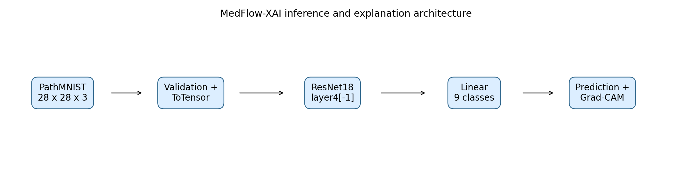

# MedFlow-XAI

MedFlow-XAI is an explainable, data-centric research pipeline for
classifying histopathology image patches from the official
[MedMNIST PathMNIST](https://medmnist.com/) dataset. It combines dataset
validation and preprocessing, PyTorch training and evaluation, Grad-CAM
visual explanations, a FastAPI inference service, and a Streamlit research
dashboard.

> **Research and educational use only.** This project is not a clinical
> diagnostic device and its predictions must not be used for medical
> decision-making.

## Problem and motivation

Medical-image classifiers can produce useful predictions while remaining
difficult to inspect or reproduce. MedFlow-XAI addresses this by connecting
the full workflow:

```text
PathMNIST -> validation -> preprocessing -> training -> evaluation
                                      -> Grad-CAM explanation
                                      -> FastAPI -> Streamlit dashboard
```

The project records dataset metadata, compares a simple CNN with ResNet18
experiments, exposes confidence and class probabilities, and provides a
visual attribution map for research inspection.

## Research question

> Can a data-centric and explainable AI pipeline improve the reliability and
> interpretability of lightweight medical-image classification systems?

The artifacts in this repository demonstrate the pipeline and its failure
modes. They do not establish clinical reliability. Whether augmentation helps
must be read from the results table below, and only if its **Run scope**
column says `full dataset`.

## Dataset

The project uses the official **PathMNIST** split from MedMNIST:

- 9 tissue classes
- 28 x 28 RGB images
- 89,996 training images
- 10,004 validation images
- 7,180 test images

The dataset is downloaded at runtime and is intentionally excluded from Git.
The checked-in summary is in
[`data/processed/dataset_summary.json`](data/processed/dataset_summary.json).

## Repository structure

```text
src/
  data/             Download, validation, and preprocessing
  database/         PostgreSQL dataset metadata utilities
  models/           CNN, ResNet18, training, evaluation, and Grad-CAM
  api/              FastAPI inference service
  research/         Figure generation and results-table rendering
  app.py, pages/    Streamlit dashboard
tests/              Pytest tests for data, models, Grad-CAM, DB, and API behavior
models/             resnet18.pth (the checkpoint served by the API and Docker)
results/            Metrics, comparisons, and confusion matrices
paper/figures/      Research figures and Grad-CAM examples
research/           Grad-CAM analysis and research report
notebooks/          Colab runner for GPU training (see "Retrain on a GPU")
```

## Requirements

- Python 3.11 or newer
- PostgreSQL for dataset metadata (started automatically by Docker Compose)
- Docker Desktop (optional, for the containerized stack)

## Installation

```bash
git clone https://github.com/Zoha257/MedFlow.git
cd MedFlow
python -m venv .venv
source .venv/bin/activate          # Windows PowerShell: .\.venv\Scripts\Activate.ps1
python -m pip install --upgrade pip
python -m pip install -r requirements.txt
cp .env.example .env               # Windows PowerShell: Copy-Item .env.example .env
```

## Reproduce the data pipeline

Start PostgreSQL (`docker compose up -d postgres`, or a local install) and
adjust the `POSTGRES_*` values in `.env` if needed. Then run:

```bash
python -m src.data.download
python -m src.data.validate
python -m src.data.preprocess
python -m src.database.db
```

The download command obtains PathMNIST, writes the dataset summary, and stores
one metadata row per split. The database commands are **idempotent**: re-running
them updates the existing `dataset_records` rows instead of adding duplicates,
and `processing_logs` receives one timed entry per split and run. No image data
is stored in PostgreSQL. Prediction persistence is opt-in through
`MEDFLOW_PERSIST_PREDICTIONS=true`.

## Train and evaluate

Train baseline and ResNet18 models for the **same number of epochs**, otherwise
the comparison is not like-for-like (`train_day3` warns if they differ):

```bash
python -m src.models.train --epochs 10 --batch-size 1024
python -m src.models.train_day3 --epochs 10 --batch-size 1024 --experiment all
```

The first command writes `models/baseline_model.pth`, `results/results.json` and
`results/confusion_matrix.png`. The second records runs in MLflow and writes
`models/resnet18.pth`, `models/resnet18_aug.pth`, per-model metrics and
confusion matrices under `results/`, and `results/model_comparison.json`.
If you hit a CUDA out-of-memory error, lower `--batch-size` (for example 256).

Smoke tests: add `--max-samples 1000 --epochs 1`. Smoke runs are written to
`*_smoke` files and `model_comparison_smoke.json`, so they can never overwrite
the real checkpoint or results. Every results file records `max_samples`
(`null` means the full dataset) and `num_predicted_classes` (fewer than 9 means
the model collapsed onto a subset of classes).

### Measured results

The table below is generated from `results/model_comparison.json`; do not
edit it by hand. After any new training run, refresh it with
`python -m src.research.render_results`.

<!-- RESULTS_TABLE_START -->

| Model | Accuracy | Macro F1 | Training time | Test inference time | Parameters | Epochs | Run scope |
| --- | ---: | ---: | ---: | ---: | ---: | ---: | --- |
| BaselineCNN | 0.6753 | 0.5923 | 776.6 s | n/a | 422,089 | 1 | not recorded |
| ResNet18 | 0.0625 | 0.0131 | 22.0 s | n/a | 11,173,449 | 1 | not recorded |
| ResNet18 + augmentation | 0.0625 | 0.0131 | 34.7 s | n/a | 11,173,449 | 1 | not recorded |

> **Caution:** BaselineCNN: run scope was not recorded (produced by an older version of the code). Re-run training to confirm it used the full dataset.
>
> **Caution:** ResNet18: run scope was not recorded (produced by an older version of the code). Re-run training to confirm it used the full dataset.
>
> **Caution:** ResNet18 + augmentation: run scope was not recorded (produced by an older version of the code). Re-run training to confirm it used the full dataset.

_Generated by `python -m src.research.render_results` from `results/model_comparison.json`._

<!-- RESULTS_TABLE_END -->

## Retrain on a GPU

CPU training is slow (one baseline epoch took about 13 minutes on CPU). Use
[`notebooks/colab_retrain.ipynb`](notebooks/colab_retrain.ipynb) on Google Colab
or Kaggle with a GPU runtime. It runs the full pipeline, regenerates every
artifact, and packages the outputs to copy back into the repository.

## Grad-CAM explanations

After training the full ResNet18 checkpoint, generate ten correct and ten
incorrect test examples:

```bash
python -m src.models.generate_gradcam
```

The command creates `paper/figures/correct_01.png` to `correct_10.png`,
`paper/figures/wrong_01.png` to `wrong_10.png`, `paper/figures/manifest.json`
and `research/gradcam_analysis.md`. The analysis file is computed from the
examples (it warns automatically if the model predicts a single class) and
ends with a manual-review template: whether a heatmap highlights relevant
tissue is a human judgement and has to be filled in by looking at the figures.

Grad-CAM is an attribution aid for model inspection. It is not proof that a
highlighted region is clinically meaningful. On 28 x 28 inputs the target layer
is only 4 x 4, so heatmaps are coarse.

## FastAPI service

```bash
python -m uvicorn src.api.main:app --reload
```

Endpoints (interactive docs at `http://localhost:8000/docs`):

- `GET /health` — model, version and device readiness
- `POST /predict` — `prediction`, `confidence`, `model_version`, plus
  `predicted_class`, `predicted_label` and all class `probabilities`
- `POST /explain` — `prediction`, `confidence`, `model_version` and `heatmap`
  (base64 PNG overlay; also returned as `heatmap_base64` for compatibility)

Uploads use a multipart field named `file`. Inputs are converted to RGB,
resized to 28 x 28, and limited to 10 MB. `model_version` defaults to
`resnet18-v1`; set `MEDFLOW_MODEL_VERSION` when you serve a new checkpoint.

```bash
curl -X POST "http://localhost:8000/predict" -F "file=@path/to/image.png"
```

## Streamlit dashboard

```bash
python -m streamlit run src/app.py
```

Open <http://localhost:8501>. The dashboard is split into Analyze, Evaluation,
Comparison, Research, and Prediction history pages. Analyze includes built-in
sample images, side-by-side original and Grad-CAM views, class probabilities,
and downloadable prediction reports. History is session-only and does not
store image bytes. Evaluation and Comparison read the saved JSON and PNG
artifacts, while Research includes the architecture diagram and limitations.

The dashboard performs local inference with the same checkpoint and
preprocessing as the API; it does not call the API over HTTP.

## Docker

```bash
docker compose up --build
```

Then open the API at `http://localhost:8000` (docs at `/docs`) and Streamlit at
`http://localhost:8501`. The image contains `models/resnet18.pth`, `results/`,
`paper/figures/` and the dataset summary, because the dashboard pages read
them. The Compose stack includes PostgreSQL with a health check and a
persistent `postgres_data` volume. Set `MEDFLOW_PERSIST_PREDICTIONS=true` in
`.env` to write API predictions to the `predictions` table.

## Testing

```bash
python -m pytest -q
```

Tests that need PathMNIST (`test_dataset.py`) or PostgreSQL (`test_db.py`)
skip themselves with a clear message when those are unavailable.

## Research artifacts

- [`research/report.md`](research/report.md) — research report
- [`research/gradcam_analysis.md`](research/gradcam_analysis.md) — explanation and error analysis
- [`paper/figures/`](paper/figures/) — dataset distribution, training curves, model comparison, architecture, Grad-CAM examples
- [`results/confusion_matrix.png`](results/confusion_matrix.png)

Regenerate the figures and the results tables with:

```bash
python -m src.research.generate_artifacts
python -m src.research.render_results
```



## Limitations and future work

This is a research prototype.

1. Read every number together with its **Run scope** and **Epochs** columns;
   smoke runs and unequal training budgets do not support model rankings.
2. PathMNIST is 28 x 28 and curated; results do not transfer to clinical
   conditions, and no clinical validation, external test set, patient-level
   split analysis or calibration study was performed.
3. Grad-CAM relevance is assessed by manual review of a small, non-random sample.
4. TODO: add dashboard screenshots and a demo video link before publishing.

## Citations

- J. Yang, R. Shi, D. Wei, Z. Liu, L. Zhao, B. Ke, H. Pfister, B. Ni,
  “MedMNIST v2 - A large-scale lightweight benchmark for 2D and 3D biomedical
  image classification,” *Scientific Data* 10, 41 (2023).
  <https://doi.org/10.1038/s41597-022-01721-8>
- J. N. Kather et al., “Predicting survival from colorectal cancer histology
  slides using deep learning: A retrospective multicenter study,” *PLOS
  Medicine* 16(1): e1002730 (2019) — the source of the underlying
  histology images (verify before citing).
- R. R. Selvaraju et al., “Grad-CAM: Visual Explanations from Deep Networks via
  Gradient-based Localization,” <https://arxiv.org/abs/1610.02391>
- Official dataset repository: <https://github.com/MedMNIST/MedMNIST>
