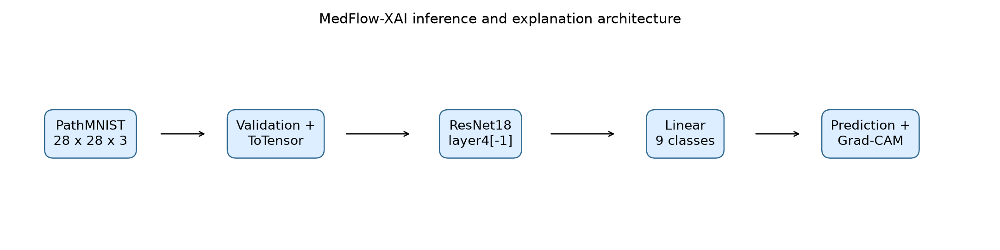
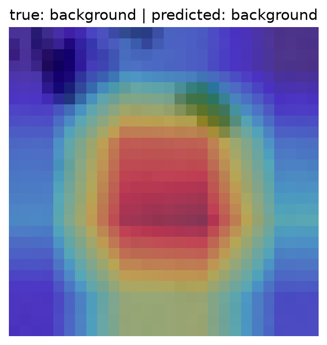

# MedFlow-XAI

MedFlow-XAI is an explainable, data-centric research pipeline for
classifying histopathology image patches from the official
[MedMNIST PathMNIST](https://medmnist.com/) dataset. It combines dataset
validation and preprocessing, PyTorch training and evaluation, Grad-CAM
visual explanations, a FastAPI inference service, and a Streamlit research
dashboard.

> **Research and educational use only.** This project is not a clinical
> diagnostic device and its predictions must not be used for medical
> decision-making.

## Project status

The core seven-day implementation is present and the automated test suite
currently passes: **12 tests passed**.

| Requirement area | Status | Evidence |
| --- | --- | --- |
| PathMNIST download, validation, and preprocessing | Implemented | `src/data/` and `data/processed/dataset_summary.json` |
| PostgreSQL dataset metadata | Implemented | `src/database/db.py` creates `dataset_records` |
| Baseline CNN and evaluation | Implemented | `src/models/train.py`, `results/results.json` |
| ResNet18 and augmentation comparison | Implemented as smoke experiments | `src/models/train_day3.py`, `results/model_comparison.json` |
| MLflow experiment tracking | Implemented | `mlflow.db` and Day 3 training script |
| Grad-CAM generation and analysis | Implemented | `src/models/generate_gradcam.py`, `research/gradcam_analysis.md` |
| FastAPI prediction and explanation API | Implemented | `/health`, `/predict`, and `/explain` |
| Streamlit dashboard | Implemented | `src/app.py` |
| Docker image for API/frontend | Implemented | `Dockerfile` and `docker-compose.yml` |
| PostgreSQL metadata, processing logs, experiments, and predictions | Implemented | `src/database/db.py` and `src/models/experiment.py` |
| Docker Compose PostgreSQL service | Implemented | `docker-compose.yml` |
| Repository license and reproducibility documentation | Implemented | `LICENSE` and `notebooks/README.md` |

The implementation is therefore suitable as a reproducible research prototype,
but it should not be described as a fully completed production or clinical
system.

## Problem and motivation

Medical-image classifiers can produce useful predictions while remaining
difficult to inspect or reproduce. MedFlow-XAI addresses this by connecting
the full workflow:

```text
PathMNIST -> validation -> preprocessing -> training -> evaluation
                                      -> Grad-CAM explanation
                                      -> FastAPI -> Streamlit dashboard
```

The project records dataset metadata, compares a simple CNN with ResNet18
experiments, exposes confidence and class probabilities, and provides a
visual attribution map for research inspection.

## Research question

> Can a data-centric and explainable AI pipeline improve the reliability and
> interpretability of lightweight medical-image classification systems?

The current artifacts demonstrate the pipeline and its failure modes. They do
not establish clinical reliability or prove that augmentation improves model
quality.

## Dataset

The project uses the official **PathMNIST** split from MedMNIST:

- 9 tissue classes
- 28 x 28 RGB images
- 89,996 training images
- 10,004 validation images
- 7,180 test images

The dataset is downloaded at runtime and is intentionally excluded from Git.
The checked-in summary is in
[`data/processed/dataset_summary.json`](data/processed/dataset_summary.json).

## Repository structure

```text
src/
  data/             Download, validation, and preprocessing
  database/         PostgreSQL dataset metadata utilities
  models/           CNN, ResNet18, training, evaluation, and Grad-CAM
  api/              FastAPI inference service
  research/         Reproducible research-artifact generation
  app.py            Streamlit dashboard
tests/              Pytest tests for data, models, Grad-CAM, and API behavior
models/             Trained checkpoint(s)
results/            Metrics, comparisons, and confusion matrices
paper/figures/      Research figures and Grad-CAM examples
research/           Grad-CAM analysis and research report
```

## Requirements

- Python 3.11 or newer
- PostgreSQL for dataset metadata
- Docker Desktop (optional, for the containerized API/frontend)

## Quick start on Windows

From PowerShell, open the repository directory:

```powershell
cd "C:\Users\My PC\Desktop\MedFlow"
```

The repository includes a virtual environment named `medflow_env`. Activate
it before running the application:

```powershell
.\medflow_env\Scripts\Activate.ps1
```

If PowerShell prevents virtual-environment activation, use the environment's
Python directly in the commands below:

```powershell
.\medflow_env\Scripts\python.exe -m streamlit run src/app.py
```

### Start the Streamlit dashboard

```powershell
python -m streamlit run src/app.py
```

Open [http://localhost:8501](http://localhost:8501) in your browser and
upload a PNG, JPG, JPEG, or BMP tissue image.

### Start the FastAPI service

Open a second PowerShell window, move to the repository directory, and
activate the environment again:

```powershell
cd "C:\Users\My PC\Desktop\MedFlow"
.\medflow_env\Scripts\Activate.ps1
python -m uvicorn src.api.main:app --reload
```

Open the interactive API documentation at
[http://localhost:8000/docs](http://localhost:8000/docs). The health endpoint
is available at [http://localhost:8000/health](http://localhost:8000/health).

The API and dashboard can run independently. The dashboard performs local
inference using the checked-in ResNet18 checkpoint.

Install Python dependencies in a virtual environment:

```powershell
py -3.13 -m venv medflow_env
.\medflow_env\Scripts\Activate.ps1
python -m pip install --upgrade pip
python -m pip install -r requirements.txt
```

If PowerShell prevents activation, run the commands with the environment's
Python directly:

```powershell
.\medflow_env\Scripts\python.exe -m pip install -r requirements.txt
```

## Reproduce the data pipeline

Copy the environment template and update the PostgreSQL values if needed:

```powershell
Copy-Item .env.example .env
```

Then run:

```powershell
python -m src.data.download
python -m src.data.validate
python -m src.data.preprocess
python -m src.database.db
```

The download command obtains PathMNIST and writes the dataset summary. The
database command creates `dataset_records`, `processing_logs`, `experiments`,
and `predictions` tables; it does not store image data. Prediction persistence
is opt-in through `MEDFLOW_PERSIST_PREDICTIONS=true`.

### PostgreSQL

PostgreSQL can be started automatically by Docker Compose. For a local
installation, use a user-owned setup such as:

```powershell
scoop install postgresql
$pg = "$env:USERPROFILE\scoop\apps\postgresql\current\bin"
$data = "$env:USERPROFILE\postgres-data-medflow"
& "$pg\initdb.exe" -D $data -U medflow --auth=trust
& "$pg\pg_ctl.exe" -D $data -l "$data\server.log" -o "-p 5432" start
& "$pg\psql.exe" -h localhost -p 5432 -U medflow -d postgres -c "CREATE DATABASE medflow;"
python -m src.database.db
```

## Train and evaluate

Train the deterministic baseline CNN:

```powershell
python -m src.models.train --epochs 1 --batch-size 1024
```

This writes `models/baseline_model.pth`, `results/results.json`, and
`results/confusion_matrix.png`.

Run the ResNet18 comparison:

```powershell
python -m src.models.train_day3 --epochs 1 --batch-size 1024 --experiment all
```

This records runs in MLflow and writes
`results/model_comparison.json`. Use `--max-samples` only for a smoke test.
Metrics from smoke tests must not be presented as full-dataset results.

### Checked-in measured results

The baseline result was a one-epoch CPU run over the full dataset:

| Model | Accuracy | Macro F1 | Training time |
| --- | ---: | ---: | ---: |
| BaselineCNN | 0.6753 | 0.5923 | 776.61 s |
| ResNet18 | 0.0625 | 0.0131 | 21.96 s |
| ResNet18 + augmentation | 0.0625 | 0.0131 | 34.67 s |

The ResNet18 rows are explicitly **smoke-run results** (one epoch and a
small evaluation sample), not evidence that the ResNet model is production
ready or better than the baseline. See
[`results/model_comparison.json`](results/model_comparison.json) for the
complete recorded metrics.

## Grad-CAM explanations

After training the full ResNet18 checkpoint, generate ten correct and ten
incorrect test examples:

```powershell
python -m src.models.generate_gradcam
```

The command creates:

- `paper/figures/correct_01.png` through `correct_10.png`
- `paper/figures/wrong_01.png` through `wrong_10.png`
- `paper/figures/manifest.json`
- `research/gradcam_analysis.md`

Grad-CAM is an attribution aid for model inspection. It is not proof that a
highlighted region is clinically meaningful.

## FastAPI service

Start the API locally:

```powershell
python -m uvicorn src.api.main:app --reload
```

Available endpoints:

- `GET /health` — model and device readiness
- `POST /predict` — predicted class, confidence, and all class probabilities
- `POST /explain` — prediction plus a base64-encoded Grad-CAM PNG overlay

Uploads use a multipart field named `file`. Inputs are converted to RGB,
resized to 28 x 28, and limited to 10 MB. Interactive documentation is
available at `http://localhost:8000/docs`.

Example request:

```powershell
curl.exe -X POST "http://localhost:8000/predict" `
  -F "file=@path\to\image.png"
```

## Streamlit dashboard

Start the dashboard in a second terminal:

```powershell
python -m streamlit run src/app.py
```

The dashboard supports:

1. Image upload
2. Predicted tissue class and confidence
3. Class-probability chart
4. Grad-CAM overlay
5. Research-use disclaimer

The API and dashboard are separate local processes. The dashboard performs
local inference using the same checkpoint and preprocessing implementation.

## Docker

Build and start the API and frontend:

```powershell
docker compose up --build
```

Then open:

- API: `http://localhost:8000`
- API docs: `http://localhost:8000/docs`
- Streamlit: `http://localhost:8501`

The Compose stack includes PostgreSQL with a health check and persistent
`postgres_data` volume. Set `MEDFLOW_PERSIST_PREDICTIONS=true` in `.env` if API
predictions should be written to the `predictions` table.

## Testing

Run the test suite:

```powershell
python -m pytest -q
```

The current repository result is **12 passed**. Tests cover dataset helpers,
preprocessing, model behavior, evaluation, Grad-CAM, and all three API
endpoints plus invalid uploads.

## Push this project to GitHub

The following steps publish your local changes to the configured GitHub
repository. Run them from the repository directory in PowerShell.

### 1. Check what will be published

```powershell
git status
git remote -v
git diff --stat
```

Do not commit `.env`, passwords, API keys, or other secrets. The local
`.env` file and the virtual environment are ignored by Git. Review any
untracked files before staging them.

### 2. Stage the project files

To stage all current project changes:

```powershell
git add .
git status
```

If a file contains private information, unstage it before continuing:

```powershell
git restore --staged path\to\private-file
```

### 3. Create a commit

```powershell
git commit -m "Document project setup and startup commands"
```

If Git asks for your identity, configure it once with your own GitHub name
and email:

```powershell
git config --global user.name "Your Name"
git config --global user.email "your-email@example.com"
```

Then run the `git commit` command again.

### 4. Push to GitHub

Check the current branch:

```powershell
git branch --show-current
```

For the current `master` branch, push with:

```powershell
git push -u origin master
```

If your branch is named `main`, use:

```powershell
git push -u origin main
```

GitHub may open a browser sign-in flow or request a personal access token.
Do not use your GitHub account password as a Git password.

### 5. Confirm the upload

```powershell
git status
git log -1 --oneline
```

Refresh [github.com/Zoha257/MedFlow](https://github.com/Zoha257/MedFlow) to
see the commit. For future updates, repeat:

```powershell
git add .
git commit -m "Describe your change"
git push
```

## Reproducibility workflows

The handover's planned notebook workflows are documented in
[`notebooks/README.md`](notebooks/README.md). The project intentionally uses
versioned command-line modules instead of stateful notebook files.

## Research artifacts

The repository contains:

- [`research/report.md`](research/report.md) — research report
- [`research/gradcam_analysis.md`](research/gradcam_analysis.md) — explanation
  and error analysis
- [`paper/figures/dataset_distribution.png`](paper/figures/dataset_distribution.png)
- [`paper/figures/training_curves.png`](paper/figures/training_curves.png)
- [`paper/figures/model_comparison.png`](paper/figures/model_comparison.png)
- [`paper/figures/architecture.png`](paper/figures/architecture.png)
- [`results/confusion_matrix.png`](results/confusion_matrix.png)

Regenerate the dataset and research figures with:

```powershell
python -m src.research.generate_artifacts
```

### Visual previews

Architecture:



Example Grad-CAM output:



## Limitations and future work

The core handover requirements are implemented, but the project remains a
research prototype:

1. The checked-in ResNet18 comparison is a one-epoch smoke experiment and
   should be rerun with the intended training budget before drawing model
   quality conclusions.
2. The current research artifacts do not constitute clinical validation.
3. Add screenshots or a short demo link when publishing the GitHub repository.

The current ResNet results are not suitable for clinical or performance claims,
and the project has not been clinically validated.

## Citations

- Yang et al., “MedMNIST v2: A Large-Scale Lightweight Benchmark for
  2D/3D Biomedical Image Classification,”
  [MedMNIST repository](https://github.com/MedMNIST/MedMNIST).
- Selvaraju et al., “Grad-CAM: Visual Explanations from Deep Networks via
  Gradient-based Localization,”
  [arXiv:1610.02391](https://arxiv.org/abs/1610.02391).
